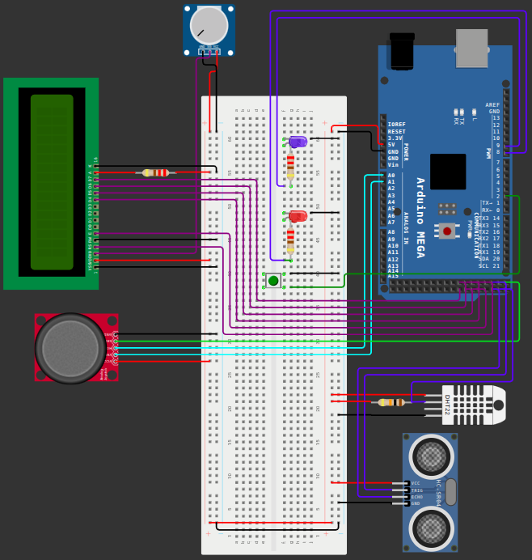

# P3_SETR - Controlador de una máquina expendedora

**Asignatura:** Sistemas Empotrados y de Tiempo Real\
**Titulación:** Grado en Ingeniería de Robótica Software\
**Curso:** 2026/2027\
**Autor:** Ivan Navarro Minaya\
**Plataforma utilizada en la implementación:** Arduino Mega 2560\
**Entorno de simulación:** Wokwi\
**Estado de la memoria:** pendiente de completar las pruebas sobre el
hardware físico

------------------------------------------------------------------------

## Índice

1.  [Introducción](#1-introducción)
2.  [Objetivos y requisitos](#2-objetivos-y-requisitos)
3.  [Proceso de diseño y decisiones
    tomadas](#3-proceso-de-diseño-y-decisiones-tomadas)
4.  [Hardware y conexiones](#4-hardware-y-conexiones)
5.  [Arquitectura general del
    software](#5-arquitectura-general-del-software)
6.  [Organización de tareas y
    temporización](#6-organización-de-tareas-y-temporización)
7.  [Interrupciones y gestión del pulsador
    externo](#7-interrupciones-y-gestión-del-pulsador-externo)
8.  [Watchdog](#8-watchdog)
9.  [Descripción detallada del
    funcionamiento](#9-descripción-detallada-del-funcionamiento)
10. [Gestión de sensores](#10-gestión-de-sensores)
11. [Gestión del joystick, LCD y
    LEDs](#11-gestión-del-joystick-lcd-y-leds)
12. [Gestión del catálogo y modificación de
    precios](#12-gestión-del-catálogo-y-modificación-de-precios)
13. [Gestión de errores y
    consideraciones](#13-gestión-de-errores-y-consideraciones)
14. [Pruebas en simulación y pruebas
    físicas](#14-pruebas-en-simulación-y-pruebas-físicas)
15. [Esquema del montaje en Wokwi](#15-esquema-del-montaje-en-wokwi)
16. [Conclusiones y aprendizaje](#16-conclusiones-y-aprendizaje)

------------------------------------------------------------------------

## 1. Introducción

En esta práctica he desarrollado el software de control de una máquina
expendedora utilizando una placa Arduino Mega 2560. El objetivo buscaba
integrar los elementos usados en un único sistema que respondiese a eventos
externos, mantuviese una interacción ordenada con el usuario y
gestionase distintas operaciones con requisitos temporales.

La máquina dispone de dos modos principales de funcionamiento: 

- Modo arranque.

- Servicio: se detecta la presencia de un usuario, se muestran las
condiciones ambientales, se permite seleccionar un producto y se simula
su preparación mediante un LED cuyo brillo aumenta progresivamente.

- Administración: permite consultar los sensores, visualizar el
tiempo transcurrido desde el encendido y modificar los precios del
catálogo.


Uno de los aspectos que más he tenido en cuenta durante el desarrollo ha
sido evitar que el programa dependa de esperas largas o de una secuencia
lineal de instrucciones. Para ello he organizado el comportamiento
mediante una máquina de estados, he separado las lecturas de los
sensores en tareas periódicas y he utilizado `millis()` para controlar
los tiempos de cada estado. También he incorporado una interrupción
hardware para detectar el pulsador externo y un Watchdog para disponer
de un mecanismo de recuperación ante bloqueos.

He desarrollado la implementación de forma progresiva. Primero organicé
los módulos y la configuración del hardware; después implementé la
máquina de estados y los elementos de entrada y salida; finalmente fui
incorporando los estados de servicio y administración. Esta forma de
trabajar me permitió probar y razonar sobre cada parte antes de
integrarla con el resto.

## 2. Objetivos y requisitos

Los requisitos funcionales que he utilizado como referencia son los
siguientes.

### 2.1. Modo de arranque

Al iniciar el controlador, el LED1 debe parpadear tres veces con
intervalos de un segundo. Durante este proceso, la pantalla LCD muestra
`CARGANDO...`. Al finalizar los tres parpadeos, el LED1 se apaga y el
sistema pasa automáticamente al estado de espera de clientes.

### 2.2. Modo de servicio

El modo de servicio constituye el funcionamiento habitual de la máquina:

-   El sensor ultrasónico mide la distancia a los posibles usuarios.
-   Cuando la distancia es inferior a un metro, el sistema comienza la
    interacción.
-   Si no se detecta un usuario dentro de ese umbral, la pantalla
    muestra `ESPERANDO CLIENTE`.
-   Al comenzar la interacción, se muestran temperatura y humedad
    durante cinco segundos.
-   Después se presenta el catálogo de cinco productos con sus precios.
-   El usuario navega por el catálogo con el eje vertical del joystick y
    confirma la selección con el pulsador integrado.
-   La preparación dura un tiempo pseudoaleatorio comprendido entre
    cuatro y ocho segundos.
-   Durante la preparación, LED2 aumenta progresivamente su brillo
    mediante PWM.
-   Al terminar, se muestra `RETIRE BEBIDA` durante tres segundos y se
    vuelve al estado de espera.
-   Una pulsación del botón externo de entre dos y tres segundos permite
    cancelar la operación y volver al inicio del modo de servicio.

Los precios iniciales son:

  Producto         Precio inicial
  -------------- ----------------
  Café Solo                1,00 €
  Café Cortado             1,10 €
  Café Doble               1,25 €
  Café Premium             1,50 €
  Chocolate                2,00 €

### 2.3. Modo de administración

Se accede manteniendo pulsado el botón externo durante al menos cinco
segundos. Mientras el sistema permanece en administración, los dos LEDs
deben estar encendidos.

El menú de administración contiene cuatro opciones:

1.  Ver temperatura.
2.  Ver distancia del sensor.
3.  Ver contador.
4.  Modificar precios.

La navegación se realiza con arriba y abajo, la selección con el botón
del joystick y el movimiento hacia la izquierda permite regresar al menú
anterior. Desde cualquier vista de administración se puede salir
manteniendo de nuevo el botón externo durante al menos cinco segundos.

Los precios se modifican en pasos de 0,05 €. El usuario puede confirmar
el nuevo importe o descartar los cambios. Los precios confirmados deben
utilizarse después en el modo de servicio. No es necesario conservarlos
después de apagar la placa.

## 3. Proceso de diseño y decisiones tomadas

### 3.1. Análisis inicial

Antes de comenzar a programar separé el comportamiento de la máquina en
estados y distinguí las entradas, las salidas y los eventos que podían
provocar una transición.

Las entradas principales son:

-   El pulsador externo, que permite cancelar operaciones o entrar y
    salir del modo de administración según el tiempo que permanezca
    pulsado.
-   El joystick, que permite navegar por los menús y confirmar
    selecciones.
-   El sensor DHT11, que proporciona temperatura y humedad.
-   El sensor ultrasónico, que permite detectar la presencia de un
    usuario y consultar la distancia.

Las salidas principales son:

-   La pantalla LCD, que informa al usuario del estado de la máquina.
-   LED1, utilizado en el arranque y como indicador del modo de
    administración.
-   LED2, utilizado para representar el progreso de preparación mediante
    PWM y también como indicador del modo de administración.

Esta separación me ayudó a decidir qué módulos debían encargarse de leer
el hardware y cuáles debían decidir qué hacer con esos datos.

### 3.2. Elección de una máquina de estados

La máquina tiene varios comportamientos que dependen del contexto. Por
ejemplo, una pulsación corta del joystick no tiene el mismo significado
en el catálogo de productos que en el menú de administración. También
hay operaciones temporizadas, como la lectura ambiental durante cinco
segundos, la preparación de una bebida o el mensaje de entrega.

Por este motivo elegí una máquina de estados finitos. Cada estado
representa una fase concreta y contiene únicamente la lógica
correspondiente a esa fase. Las transiciones se solicitan mediante una
función común, en lugar de cambiar directamente la variable del estado
desde cualquier módulo.

Esta decisión facilita seguir el flujo de ejecución, evita mezclar
comportamientos y permite añadir estados sin tener que convertir el
programa en una única función extensa.

### 3.3. Separación entre hardware y lógica

Organicé el proyecto en dos bloques principales:

-   `Hardware/`: contiene los módulos que controlan directamente los
    componentes.
-   `System/`: contiene la lógica de la máquina, la gestión de eventos,
    los sensores periódicos, los productos y los estados.

Además, creé `Config.h` para centralizar los pines y los parámetros
temporales. De esta forma, si necesito cambiar una conexión o un
intervalo, puedo localizarlo en un único archivo.

### 3.4. Desarrollo progresivo

La implementación se fue construyendo por partes. Primero centralicé los
pines y organicé los módulos. Después trabajé en la máquina de estados,
el botón externo y el joystick. A continuación incorporé la lectura
periódica de los sensores y el catálogo. Finalmente implementé los
estados de servicio y administración.

Durante el proceso también fui ajustando detalles de diseño. Por
ejemplo, decidí almacenar los precios en céntimos enteros en lugar de
utilizar `float`, para evitar problemas de representación y redondeo.
También añadí funciones para formatear los precios y para actualizar
líneas concretas del LCD sin tener que limpiar toda la pantalla en cada
cambio.

## 4. Hardware y conexiones

### 4.1. Componentes utilizados

La implementación contempla los siguientes componentes:

-   Arduino Mega 2560.
-   Pantalla LCD de 16 columnas y 2 filas.
-   Módulo joystick analógico con pulsador.
-   Sensor de temperatura y humedad DHT11.
-   Sensor ultrasónico HC-SR04.
-   Pulsador externo.
-   LED1 rojo.
-   LED2 verde.

> La simulación del montaje se ha realizado en Wokwi. La imagen del
> esquema se incluirá en el apartado 15.

### 4.2. Asignación de pines

La asignación utilizada está centralizada en `src/Config.h`.

  Elemento            Señal                 Pin del Arduino Mega 2560
  ------------------- ------------------- ---------------------------
  Pulsador externo    Señal digital                                D2
  LED1 rojo           Salida digital                               D8
  LED2 verde          Salida PWM                                   D9
  LCD                 RS                                          D30
  LCD                 Enable                                      D31
  LCD                 D4                                          D32
  LCD                 D5                                          D33
  LCD                 D6                                          D34
  LCD                 D7                                          D35
  Joystick            Eje X                                        A0
  Joystick            Eje Y                                        A1
  Joystick            Pulsador                                    D22
  DHT11               Datos                                       D23
  HC-SR04             Trigger                                     D24
  HC-SR04             Echo                                        D25
  Semilla aleatoria   Entrada analógica                           A15

El LED2 está conectado a un pin con capacidad PWM, ya que necesito
controlar su intensidad y no solamente encenderlo o apagarlo. El
pulsador externo se conecta a un pin que permite utilizar una
interrupción externa en el Mega 2560.

El pulsador externo y el botón del joystick se configuran con
`INPUT_PULLUP`. En esta configuración, el estado normal es HIGH y la
pulsación conecta la entrada a GND, por lo que se detecta como LOW.

## 5. Arquitectura general del software

La estructura del proyecto es la siguiente:

``` text
main/
├── main.ino
└── src/
    ├── Config.h
    ├── Hardware/
    │   ├── DHTSensor.h
    │   ├── DHTSensor.cpp
    │   ├── Joystick.h
    │   ├── Joystick.cpp
    │   ├── LCD.h
    │   ├── LCD.cpp
    │   ├── LEDs.h
    │   ├── LEDs.cpp
    │   ├── Ultrasonic.h
    │   └── Ultrasonic.cpp
    └── System/
        ├── AdminStates.cpp
        ├── Button.h
        ├── Button.cpp
        ├── Products.h
        ├── Products.cpp
        ├── Sensors.h
        ├── Sensors.cpp
        ├── ServiceStates.cpp
        ├── StateMachine.h
        ├── StateMachine.cpp
        └── States.h
```

### 5.1. `main.ino`

Es el punto de entrada del programa. Su responsabilidad es inicializar
los módulos y ejecutar el bucle principal. No contiene la lógica
detallada de los estados, sino que coordina los módulos del sistema.

En `setup()` se inicializan los LEDs, la pantalla, el DHT11, el
joystick, el sensor ultrasónico, las tareas periódicas y el pulsador
externo. También se inicializa la semilla del generador pseudoaleatorio
y se activa el Watchdog una vez terminada la configuración.

El `loop()` sigue este orden:

1.  Refresca el Watchdog.
2.  Ejecuta las tareas periódicas de los sensores.
3.  Procesa los eventos del pulsador externo.
4.  Aplica las transiciones pendientes de la máquina de estados.
5.  Actualiza el evento del joystick.
6.  Ejecuta la función correspondiente al estado actual.

Este orden permite que las lecturas y los eventos se actualicen antes de
ejecutar la lógica del estado.

### 5.2. `Config.h`

Centraliza la configuración global:

-   Pines de los componentes.
-   Tipo de sensor DHT.
-   Intervalos de lectura.
-   Umbral de detección de presencia.
-   Tiempos de pulsación del botón externo.
-   Umbrales del joystick.
-   Paso de modificación de precios y límites configurados.
-   Timeout del Watchdog.
-   Tiempos de arranque, entorno, preparación y entrega.

También contiene las macros de depuración `LOG_PRINT` y `LOG_PRINTLN`,
que permiten activar o desactivar las trazas del puerto serie desde un
único lugar.

### 5.3. Módulos de hardware

Cada módulo encapsula las operaciones de un componente:

-   `DHTSensor`: inicializa el DHT11 y devuelve temperatura y humedad.
-   `Ultrasonic`: genera el pulso de disparo y mide el tiempo de retorno
    del eco.
-   `LCD`: inicializa la pantalla, muestra mensajes y actualiza una fila
    concreta.
-   `LEDs`: inicializa los LEDs y permite controlar su estado o brillo.
-   `Joystick`: lee los ejes y el pulsador, aplica los umbrales y genera
    eventos.

Así, los estados no necesitan conocer los detalles eléctricos de cada
componente. Por ejemplo, un estado solicita mostrar un mensaje mediante
`showLCDMessage()` sin tener que controlar directamente el objeto
`LiquidCrystal`.

### 5.4. Módulos del sistema

Los módulos de `System/` implementan la lógica de la aplicación:

-   `StateMachine`: mantiene el estado actual, procesa las peticiones de
    transición y ejecuta el estado correspondiente.
-   `States`: declara las funciones de los estados.
-   `ServiceStates`: implementa arranque y modo de servicio.
-   `AdminStates`: implementa el menú y las vistas de administración.
-   `Button`: interpreta las pulsaciones del botón externo.
-   `Sensors`: coordina las lecturas periódicas y conserva los últimos
    valores.
-   `Products`: mantiene el catálogo y sus precios.

## 6. Organización de tareas y temporización

### 6.1. Bucle cooperativo

El programa utiliza un único `loop()` principal. No he creado hilos de
ejecución independientes ni varios núcleos de ejecución. La ejecución se
organiza de forma cooperativa: en cada iteración se realizan las tareas
que correspondan y se ejecuta el estado actual.

Esto es importante para describir correctamente el uso de
`ArduinoThread`: la biblioteca permite programar funciones periódicas
que se comprueban y ejecutan desde el bucle principal, pero no crea
hilos de hardware ni ejecuta código simultáneamente en paralelo.

### 6.2. ArduinoThread y ThreadController

En `Sensors.cpp` he utilizado dos objetos `Thread` y un
`ThreadController`:

-   La tarea `dhtThread` ejecuta `readDHTTask()` cada 2000 ms.
-   La tarea `distanceThread` ejecuta `readDistanceTask()` cada 150 ms.
-   `sensorController.run()` se llama desde `updateSensors()`, que a su
    vez se ejecuta en cada vuelta del `loop()`.

La finalidad es desacoplar la frecuencia de lectura de los sensores de
la lógica de los estados. Los estados no deciden cuándo debe realizarse
una lectura física; simplemente consultan el último valor disponible.

Cuando una lectura del DHT es válida, se actualizan temperatura y
humedad y se activa una bandera que indica que hay datos nuevos. En el
caso del ultrasónico, cada medición actualiza la distancia y activa su
propia bandera. Las funciones `hasNewDHTReading()` y
`hasNewDistanceReading()` consumen esas notificaciones para que los
estados puedan actualizar la pantalla una sola vez por cada nueva
lectura.

Por tanto, la planificación es periódica y cooperativa, no una ejecución
paralela real.

### 6.3. Temporización mediante `millis()`

Para controlar los tiempos de los estados utilizo `millis()`, que
devuelve el número de milisegundos transcurridos desde el arranque de
Arduino.

La máquina de estados mantiene `stateEntryTime`, que registra el
instante en el que se entra en el estado actual. Para comprobar si ha
transcurrido un intervalo se utiliza una resta:

``` cpp
if (millis() - stateEntryTime >= tiempoNecesario) {
    // Solicitar la transición correspondiente
}
```

Esta forma de calcular el tiempo evita depender de esperas bloqueantes y
es adecuada para temporizaciones basadas en el tiempo transcurrido.

También utilizo variables `static` locales en algunos estados cuando
necesito conservar un dato entre iteraciones, por ejemplo el instante de
la siguiente fase del parpadeo o el último segundo mostrado en el
contador.

### 6.4. Esperas bloqueantes del sensor ultrasónico

La mayor parte de la lógica de la aplicación se ha diseñado sin
`delay()`. Sin embargo, la lectura del HC-SR04 utiliza `pulseIn()` con
un timeout de 12000 microsegundos. La generación del pulso Trigger
también necesita dos pequeñas esperas mediante `delayMicroseconds()`.

Por tanto, la medición ultrasónica puede bloquear la ejecución durante
un máximo aproximado de 12 ms, además del tiempo de generación del
pulso. He limitado el timeout para que una ausencia de eco no mantenga
bloqueado el programa indefinidamente.

Esta lectura se ejecuta de forma periódica cada 150 ms. La planificación
periódica no elimina el bloqueo de `pulseIn()`: únicamente controla
cuándo se inicia cada medición. Esta solución se mantuvo teniendo en
cuenta el criterio indicado durante el desarrollo de la práctica sobre
la aceptación de los tiempos de espera propios de la medición
ultrasónica.

### 6.5. Uso de TimerOne

No he utilizado la biblioteca `TimerOne` en la versión final. Para las
necesidades de esta implementación he utilizado `ArduinoThread`,
`millis()` y la interrupción externa del pulsador. He preferido no
añadir otro mecanismo de temporización si no era necesario para resolver
los requisitos.

## 7. Interrupciones y gestión del pulsador externo

### 7.1. Motivo de utilizar una interrupción

El botón externo tiene dos funciones distintas según el tiempo que
permanezca pulsado:

-   Entre dos y tres segundos: cancelar la operación y volver al inicio
    del modo de servicio.
-   Cinco segundos o más: entrar en administración o salir de ella.

Como la duración de la pulsación es importante, no quería depender
únicamente de consultar el pin en determinados puntos del programa. Por
eso configuré una interrupción hardware asociada a los cambios de nivel
del pulsador.

En el Arduino Mega 2560 el pulsador está conectado a D2 y se configura
con
`attachInterrupt(digitalPinToInterrupt(BUTTON_PIN), handleButton, CHANGE)`.

### 7.2. Funcionamiento de la ISR

La rutina `handleButton()` es breve. Su responsabilidad es registrar el
instante del flanco y activar una bandera (`interruptPending`). No
realiza operaciones con la pantalla, no imprime mensajes por el puerto
serie y no ejecuta la lógica de los estados.

Las variables compartidas con la interrupción se declaran `volatile`, ya
que pueden cambiar fuera del flujo normal del programa.

### 7.3. Antirrebote y clasificación

El procesamiento completo se realiza después, en `processButton()`,
desde el `loop()`:

1.  Se copian de forma segura las variables compartidas con la ISR,
    deshabilitando brevemente las interrupciones.
2.  Se espera el intervalo de antirrebote definido en `DEBOUNCE_TIME`.
3.  Se comprueba el estado real del pin.
4.  Cuando se detecta una pulsación estable, se registra el instante
    inicial.
5.  Cuando se detecta una liberación estable, se calcula la duración a
    partir de los instantes de los flancos.
6.  La duración se clasifica como `EVENT_RESET`, `EVENT_ADMIN` o
    `EVENT_NONE`.

La clasificación se realiza al completar la pulsación, es decir, cuando
el usuario suelta el botón. Los intervalos están centralizados en
`Config.h`: 30 ms de antirrebote, entre 2000 y 3000 ms para reset y 5000
ms o más para administración.

Una pulsación que no entra en ninguno de esos intervalos no genera una
acción. En particular, las duraciones superiores a tres segundos e
inferiores a cinco no se clasifican como reset ni como administración.

La máquina de estados recibe el evento mediante `updateStateByButton()`.
De esta forma, el módulo `Button` no necesita conocer los estados ni
controlar directamente los LEDs.

## 8. Watchdog

He incorporado el Watchdog del microcontrolador AVR para disponer de un
mecanismo de recuperación si el programa deja de ejecutarse
correctamente.

En `setup()` primero se llama a `wdt_disable()`. Esto evita que un
Watchdog que haya quedado activo tras un reinicio anterior interfiera
con la inicialización. Una vez inicializados los módulos, se activa
mediante `wdt_enable(WATCHDOG_TIMEOUT)`, con un timeout configurado como
`WDTO_2S`.

Al comienzo de cada iteración del `loop()` se ejecuta `wdt_reset()`. Si
el programa deja de alcanzar esa instrucción durante el intervalo
configurado, el Watchdog provoca un reinicio del microcontrolador.

La finalidad es detectar un bloqueo general del flujo de ejecución y
recuperar el sistema. No sustituye a la gestión de errores de los
sensores ni garantiza que todas las operaciones sean correctas: es un
mecanismo adicional de seguridad.

## 9. Descripción detallada del funcionamiento

La máquina de estados utiliza un único estado actual (`currentState`) y
una petición de transición pendiente. Los estados no modifican
directamente `currentState`; llaman a `requestStateChange()`. Después,
`updateStateMachine()` aplica la transición y ejecuta las acciones de
salida y entrada.

Las variables `stateEntryTime` y `stateJustEntered` permiten que cada
estado ejecute sus acciones de inicialización una sola vez y mida el
tiempo desde su entrada.

### 9.1. Estados implementados

  -----------------------------------------------------------------------
  Estado                              Función
  ----------------------------------- -----------------------------------
  `STARTUP`                           Secuencia inicial de parpadeo y
                                      mensaje de carga

  `SERVICE_WAITING`                   Espera de presencia de un usuario

  `SERVICE_ENVIRONMENT`               Visualización temporal de
                                      temperatura y humedad

  `SERVICE_MENU`                      Navegación y selección de productos

  `SERVICE_PREPARING`                 Preparación temporizada y progreso
                                      PWM

  `SERVICE_DELIVERY`                  Mensaje de retirada de bebida

  `ADMIN_MENU`                        Menú principal de administración

  `ADMIN_TEMPERATURE`                 Consulta dinámica del DHT11

  `ADMIN_DISTANCE`                    Consulta dinámica del sensor
                                      ultrasónico

  `ADMIN_COUNTER`                     Contador de segundos desde el
                                      arranque

  `ADMIN_PRICES`                      Selección de un producto para
                                      modificar su precio

  `ADMIN_PRICE_EDIT`                  Edición, confirmación o descarte
                                      del precio
  -----------------------------------------------------------------------

### 9.2. Arranque: `STARTUP`

Al entrar en `STARTUP`, la pantalla muestra `CARGANDO...`, se inicializa
el contador de parpadeos y se enciende LED1.

El estado utiliza `phaseStartTime` para controlar las fases de encendido
y apagado. Cada vez que transcurre `STARTUP_BLINK_INTERVAL`, se invierte
el estado del LED. Se cuenta un parpadeo cuando el LED vuelve a
apagarse.

Al completar tres parpadeos se solicita la transición a
`SERVICE_WAITING`. La transición también ejecuta la acción de salida que
apaga LED1.

No utilizo `delay()` para mantener encendido o apagado el LED. El estado
comprueba el tiempo transcurrido en cada iteración del bucle.

### 9.3. Espera de usuario: `SERVICE_WAITING`

Al entrar se muestra:

``` text
ESPERANDO
CLIENTE...
```

El estado consulta `isClientPresent()`, que utiliza la última distancia
medida por el sensor ultrasónico. Se considera que hay un cliente cuando
la distancia es válida y menor que `CLIENT_DISTANCE`, configurada a 100
cm.

Si el sensor no recibe eco, la lectura es `-1` y se interpreta como
ausencia de cliente. Cuando se detecta presencia, se solicita la
transición a `SERVICE_ENVIRONMENT`.

### 9.4. Monitorización ambiental: `SERVICE_ENVIRONMENT`

Al entrar se muestran la temperatura y la humedad si ya existe una
lectura válida del DHT11. Si todavía no hay datos válidos, se muestra
temporalmente `LEYENDO AMBIENTE...`.

La función `hasNewDHTReading()` permite detectar nuevas lecturas. Cuando
hay una nueva muestra válida, se actualizan las dos líneas del LCD. La
pantalla permanece en este estado durante cinco segundos, medidos desde
`stateEntryTime`, y después se solicita la transición a `SERVICE_MENU`.

Los valores se redondean para mostrarlos de forma compacta en la
pantalla de 16 columnas.

### 9.5. Catálogo: `SERVICE_MENU`

El catálogo contiene cinco productos. Como la pantalla tiene dos filas y
dieciséis columnas, he optado por mostrar un producto cada vez en lugar
de intentar representar todos simultáneamente.

La primera línea muestra el nombre del producto precedido por un
indicador de selección. La segunda muestra su precio. El joystick
permite desplazarse hacia arriba o abajo por los índices del catálogo.
La navegación tiene límites y no es circular.

El botón integrado del joystick confirma el producto seleccionado y
solicita `SERVICE_PREPARING`.

### 9.6. Preparación: `SERVICE_PREPARING`

Al entrar en el estado se genera un tiempo pseudoaleatorio entre
`PREPARATION_MIN_TIME` y `PREPARATION_MAX_TIME`, configurados en 4000 y
8000 ms. La llamada a `random()` utiliza un límite superior exclusivo,
por lo que se suma una unidad al máximo para incluir 8000 ms.

La semilla se inicializa en `setup()` mediante
`randomSeed(analogRead(RANDOM_SEED_PIN))`, utilizando A15 como entrada
analógica sin conectar en la configuración actual.

El LCD muestra `PREPARANDO...` y el nombre del producto. LED2 comienza
apagado. En cada iteración se calcula el tiempo transcurrido desde la
entrada al estado y se obtiene un brillo proporcional al progreso:

``` cpp
uint8_t brightness = elapsedTime * 255 / preparationTime;
```

El resultado se envía a `setLED2()`, que utiliza `analogWrite()` sobre
D9. Así, el brillo aumenta desde 0 hasta aproximarse al máximo conforme
avanza la preparación.

Cuando el tiempo transcurrido alcanza el tiempo de preparación, se
solicita `SERVICE_DELIVERY`. La acción de salida del estado apaga LED2.

El tiempo se genera de nuevo en cada preparación. Al tratarse de una
selección pseudoaleatoria independiente, dos preparaciones podrían
obtener casualmente el mismo valor; el programa no mantiene un historial
para forzar que cada duración sea distinta de todas las anteriores.

### 9.7. Entrega: `SERVICE_DELIVERY`

Al entrar se muestra `RETIRE BEBIDA`. El estado mide tres segundos
mediante `millis()` y después solicita volver a `SERVICE_WAITING`.

No se utiliza ninguna espera bloqueante, por lo que el resto de las
tareas del bucle puede seguir ejecutándose durante ese intervalo.

### 9.8. Acceso y salida de administración

El acceso al modo de administración se produce cuando `processButton()`
devuelve `EVENT_ADMIN`. Si el estado actual pertenece al modo de
servicio, la máquina solicita `ADMIN_MENU`. Si pertenece al modo de
administración, solicita `SERVICE_WAITING`.

La función `isAdminState()` permite identificar todos los estados que
pertenecen al modo de administración. Las acciones comunes de entrada y
salida se centralizan en `onEnterState()` y `onExitState()`.

Al entrar en administración se encienden LED1 y LED2. Al salir del modo
se apagan ambos LEDs.

### 9.9. Menú de administración: `ADMIN_MENU`

El menú tiene cuatro opciones: temperatura, distancia, contador y
modificación de precios.

La opción seleccionada se conserva en una variable estática local.
Arriba y abajo permiten navegar por las opciones, con límites en el
primer y último elemento. El botón del joystick solicita el estado
asociado a la opción seleccionada.

Cuando se entra en la opción de precios, el índice del producto se
inicializa para comenzar por el primer elemento del catálogo.

### 9.10. Consulta de temperatura: `ADMIN_TEMPERATURE`

Esta vista muestra las últimas lecturas válidas de temperatura y
humedad. Al entrar, si ya hay una lectura disponible, se muestra
inmediatamente; en caso contrario, aparece un mensaje de espera.

La pantalla se actualiza cuando `hasNewDHTReading()` indica que se ha
recibido una nueva muestra. El movimiento del joystick hacia la
izquierda solicita volver a `ADMIN_MENU`.

### 9.11. Consulta de distancia: `ADMIN_DISTANCE`

La vista muestra la última distancia medida por el HC-SR04 y actualiza
la segunda línea del LCD cuando se completa una nueva medición.

Si el sensor no recibe eco dentro del timeout configurado, se muestra
`FUERA DE RANGO`. El timeout actual es de 12000 microsegundos, que
equivale aproximadamente a un alcance de dos metros teniendo en cuenta
el recorrido de ida y vuelta del sonido.

El movimiento hacia la izquierda permite regresar al menú de
administración.

### 9.12. Contador: `ADMIN_COUNTER`

El contador muestra los segundos transcurridos desde el arranque de
Arduino, calculados mediante `millis() / 1000`.

Se conserva el último segundo mostrado y solo se actualiza la pantalla
cuando cambia el valor. El movimiento hacia la izquierda permite volver
al menú.

El contador mide el tiempo desde el arranque de la placa, no el tiempo
que lleva activa la vista de administración.

### 9.13. Listado y edición de precios

En `ADMIN_PRICES` se navega por los cinco productos y se muestra el
precio almacenado. Al pulsar el botón del joystick se entra en
`ADMIN_PRICE_EDIT`.

En la edición se copia el precio actual a `editingPrice`. Esta variable
es provisional: los movimientos arriba y abajo la incrementan o
decrementan en `PRICE_STEP`, configurado en cinco céntimos. El LCD se
actualiza en cada modificación para que el usuario pueda ver el importe
antes de confirmarlo.

Al pulsar el botón del joystick se llama a `setProductPrice()` y el
nuevo valor pasa al catálogo. Si se mueve el joystick hacia la
izquierda, se vuelve al listado sin llamar a esa función, por lo que se
descarta el valor provisional.

Los precios se almacenan en céntimos enteros. La función `formatPrice()`
convierte el importe a una cadena con dos decimales, por ejemplo `1.10`,
sin depender de operaciones de coma flotante para formatear el precio.

La configuración actual limita el precio entre 0,05 € y 9,95 €, en pasos
de 0,05 €. Estos límites son decisiones de implementación añadidas al
requisito de modificar precios en tramos de cinco céntimos; no son
límites especificados por el enunciado.

Los precios confirmados permanecen en la memoria RAM mientras la placa
está encendida. No se guardan en EEPROM, tal como permite el enunciado.

## 10. Gestión de sensores

### 10.1. DHT11

El módulo `DHTSensor` encapsula la biblioteca del DHT. `readDHT()`
obtiene temperatura y humedad y comprueba si las lecturas son válidas
mediante `isnan()`.

En `Sensors.cpp`, si la lectura es válida, se actualizan los últimos
valores y se activa `newDHTReading`. Si falla, se conservan los últimos
valores válidos y se registra un mensaje de depuración.

El periodo de lectura configurado es de 2000 ms, adecuado para el
intervalo de actualización que necesita el DHT11.

### 10.2. Sensor ultrasónico HC-SR04

El módulo `Ultrasonic` configura Trigger como salida y Echo como
entrada. Para realizar una medida, genera un pulso Trigger de 10
microsegundos y utiliza `pulseIn()` para medir la duración del eco.

La distancia se calcula a partir del tiempo de vuelo del sonido:

$$
d = \frac{t \cdot 0{,}0343}{2}
$$

donde `t` está expresado en microsegundos y la distancia obtenida está
en centímetros. Se divide entre dos porque el sonido recorre el trayecto
de ida y vuelta.

El timeout está configurado a 12000 microsegundos. Si no se recibe el
eco, la función devuelve `-1`, que el resto del programa interpreta como
una medición no válida o fuera de rango.

El periodo de lectura es de 150 ms. Esto deja un intervalo entre
disparos superior al mínimo habitual requerido por el HC-SR04.

### 10.3. Conservación de las últimas medidas

El módulo `Sensors` conserva las últimas medidas de ambos sensores. Esto
evita que cada estado tenga que iniciar una lectura física por su
cuenta.

Las banderas `newDHTReading` y `newDistanceReading` sirven para
notificar que existe una nueva muestra desde la última consulta. Las
funciones `hasNewDHTReading()` y `hasNewDistanceReading()` consumen la
notificación al devolver `true`.

## 11. Gestión del joystick, LCD y LEDs

### 11.1. Joystick

El joystick se consulta por sondeo en cada iteración del bucle
principal. Los ejes analógicos se leen mediante `analogRead()` y se
comparan con los umbrales definidos en `Config.h`.

La posición central aproximada es 512. Los umbrales actuales son 200 y
800. El eje Y tiene prioridad sobre el eje X para clasificar la
dirección.

El módulo genera un evento cuando la dirección cambia respecto a la
iteración anterior, evitando repetir continuamente el mismo movimiento
mientras la palanca permanece inclinada. El pulsador integrado se lee
también por sondeo y dispone de un antirrebote de 50 ms. El evento de
click se genera al pasar de suelto a pulsado y tiene prioridad si
coincide con un movimiento.

### 11.2. Pantalla LCD

La pantalla utilizada es de 16 columnas por 2 filas. El módulo `LCD`
ofrece funciones para inicializarla, limpiar su contenido, mostrar dos
líneas y actualizar una línea concreta.

Al actualizar una fila, se escriben los caracteres del mensaje y se
rellenan las posiciones restantes con espacios. De esta forma se evitan
restos de mensajes anteriores cuando el nuevo texto es más corto.

Los mensajes que superan las dieciséis columnas se recortan y generan
una traza de aviso si la depuración está activada.

### 11.3. LEDs

LED1 se controla como salida digital mediante `setLED1()`. Se utiliza en
la secuencia de arranque y permanece encendido durante el modo de
administración.

LED2 se controla mediante `setLED2()`, que utiliza `analogWrite()` para
establecer un valor entre 0 y 255. En el modo de servicio representa el
progreso de preparación. En administración se mantiene encendido como
indicador de estado.

Las acciones comunes de encendido y apagado al entrar y salir del modo
de administración están centralizadas en la máquina de estados.

## 12. Gestión del catálogo y modificación de precios

El catálogo está encapsulado en `Products.cpp`. Los nombres y los
precios se almacenan en arrays privados del módulo. El resto del
programa accede a ellos mediante funciones públicas:

-   `getProductName()`: devuelve el nombre del producto.
-   `getProductPrice()`: devuelve el precio en céntimos.
-   `setProductPrice()`: actualiza el precio si el índice y el importe
    son válidos.
-   `formatPrice()`: convierte el precio a una cadena con dos decimales.

He elegido almacenar los precios como enteros en céntimos. Por ejemplo,
1,10 € se representa internamente como 110. Esto evita errores de
precisión que pueden aparecer al realizar sumas y restas repetidas con
números de coma flotante.

La edición utiliza una copia temporal. De esta forma, el usuario puede
probar distintos importes y verlos en el LCD sin alterar todavía el
catálogo. La modificación solo se hace efectiva cuando confirma con el
botón del joystick.

Los cambios confirmados son visibles en el modo de servicio porque ambos
modos consultan el mismo módulo `Products`. No se necesita una segunda
copia del catálogo para el servicio y otra para administración.

## 13. Gestión de errores y consideraciones

### 13.1. Lecturas no válidas del DHT11

Si el DHT11 devuelve una lectura no válida, el módulo no sobrescribe los
últimos valores correctos. Se registra el error y se espera a la
siguiente lectura periódica.

### 13.2. Ausencia de eco ultrasónico

Si `pulseIn()` termina por timeout, `getDistance()` devuelve `-1`. El
sistema interpreta ese valor como ausencia de una medida válida. En el
estado de espera no se considera que haya un cliente presente y en la
vista de administración se muestra `FUERA DE RANGO`.

### 13.3. Índices del catálogo

Las funciones del módulo `Products` comprueban que el índice pertenece
al catálogo antes de acceder a los arrays. Si el índice no es válido,
las funciones de consulta devuelven un valor neutro y la función de
modificación no realiza cambios.

## 14. Pruebas en simulación y pruebas físicas

Este apartado queda reservado para documentar las pruebas finales. No
incluyo resultados físicos todavía porque deben completarse después de
montar y ejecutar el proyecto sobre la placa real.

### 14.1. Pruebas en Wokwi

Durante el desarrollo he utilizado Wokwi para representar el circuito y
comprobar la integración del software con los componentes simulados.

**Pendiente de completar:** describir aquí las pruebas realizadas en
Wokwi, indicando qué funcionalidades se comprobaron, qué resultados se
observaron y qué ajustes fueron necesarios. No se deben presentar como
verificadas funcionalidades que no se hayan probado realmente.

### 14.2. Pruebas sobre Arduino físico

Una vez montado el circuito, documentaré las pruebas realizadas sobre
Arduino Mega 2560. Para cada prueba indicaré:

-   Objetivo.
-   Procedimiento seguido.
-   Resultado esperado.
-   Resultado obtenido.
-   Problemas detectados.
-   Ajustes realizados, si los hubiera.

#### Lista de comprobaciones

-   [ ] Arranque: tres parpadeos de LED1 y mensaje `CARGANDO...`.
-   [ ] Transición automática al estado de espera.
-   [ ] Detección de presencia por debajo de un metro.
-   [ ] Mensaje de espera cuando no hay ningún usuario.
-   [ ] Lectura de temperatura y humedad.
-   [ ] Visualización ambiental durante cinco segundos.
-   [ ] Navegación por los cinco productos.
-   [ ] Visualización correcta de los precios.
-   [ ] Confirmación de un producto.
-   [ ] Duración de preparación entre cuatro y ocho segundos.
-   [ ] Incremento progresivo del brillo de LED2.
-   [ ] Mensaje `RETIRE BEBIDA` durante tres segundos.
-   [ ] Cancelación mediante una pulsación de entre dos y tres segundos.
-   [ ] Acceso al modo administración con una pulsación de cinco
    segundos o más.
-   [ ] Encendido de ambos LEDs durante administración.
-   [ ] Navegación por las cuatro opciones del menú de administración.
-   [ ] Consulta dinámica de temperatura y humedad.
-   [ ] Consulta dinámica de distancia.
-   [ ] Actualización del contador segundo a segundo.
-   [ ] Incremento y decremento del precio en pasos de cinco céntimos.
-   [ ] Confirmación de un precio y comprobación en el modo servicio.
-   [ ] Descarte de una edición sin modificar el catálogo.
-   [ ] Salida del modo administración mediante el botón externo.
-   [ ] Funcionamiento estable del Watchdog.

### 14.3. Vídeo de demostración

Vídeo de las pruebas físicas:


### 14.4. Incidencias y ajustes realizados

  Incidencia observada           Causa identificada   Solución aplicada
  ------------------------------ -------------------- -------------------
  Pendiente de pruebas físicas   ---                  ---

## 15. Esquema del montaje

El montaje se ha representado en Wokwi para visualizar las conexiones
entre el microcontrolador y los componentes. 



### 15.1. Descripción de las conexiones

El pulsador externo se conecta a D2 y utiliza la resistencia pull-up
interna del microcontrolador. Los dos LEDs se conectan a D8 y D9; el
segundo utiliza PWM para regular su brillo.

La pantalla LCD se conecta en modo de cuatro bits, utilizando RS en D30,
Enable en D31 y las líneas de datos D4--D7 en D32--D35.

El joystick utiliza las entradas analógicas A0 y A1 para sus ejes y D22
para el pulsador integrado. El DHT11 utiliza D23 como línea de datos. El
sensor ultrasónico conecta Trigger a D24 y Echo a D25.

La imagen debe mostrar el montaje completo y permitir contrastar estas
conexiones con la tabla de asignación de pines del apartado 4.

## 16. Conclusiones y aprendizaje

Esta práctica me ha permitido aplicar de forma conjunta varios conceptos
de sistemas empotrados y de tiempo real. La parte más importante no ha
sido únicamente conseguir que cada componente funcione, sino organizar
el programa para que todos puedan trabajar dentro de un mismo flujo de
ejecución sin que una operación sencilla bloquee el resto del sistema.

Una de las primeras decisiones relevantes fue utilizar una máquina de
estados. Al principio podía parecer más sencillo implementar el
comportamiento con una secuencia de condiciones, pero al incorporar los
menús, las temporizaciones y las operaciones de administración resultaba
más claro separar cada fase. La máquina de estados me ha permitido
identificar qué debe ocurrir al entrar en cada fase, qué eventos pueden
producir una transición y qué acciones deben ejecutarse al abandonar un
estado.

También he aprendido a separar la lógica de aplicación del control del
hardware. La creación de módulos específicos para LCD, LEDs, joystick,
DHT11 y ultrasonidos evita que los estados tengan que conocer los
detalles de bajo nivel. A su vez, `Config.h` facilita mantener una
configuración común y reduce la posibilidad de que un mismo pin o
parámetro aparezca definido de forma diferente en varios archivos.

Otro aspecto importante ha sido comprender la diferencia entre utilizar
tareas periódicas y crear hilos de ejecución reales. Con `ArduinoThread`
he organizado las lecturas de los sensores para que se ejecuten con
intervalos definidos desde el bucle cooperativo. Esto permite que el
resto del programa siga avanzando entre lecturas, aunque no significa
que las funciones se ejecuten en paralelo. Esta distinción es importante
en un microcontrolador que ejecuta un único flujo principal.

El uso de `millis()` ha sido fundamental para evitar esperas largas con
`delay()`. Lo he aplicado al arranque, a la visualización ambiental, a
la preparación, a la entrega y al contador. De esta forma, los estados
pueden comprobar si ha transcurrido el tiempo necesario sin detener el
bucle principal.

La gestión del pulsador externo me ha permitido trabajar con
interrupciones hardware. La ISR se limita a registrar el instante de los
flancos y el procesamiento posterior se realiza en el flujo principal.
Así puedo medir la duración de la pulsación y clasificarla sin realizar
operaciones lentas dentro de la interrupción. También he tenido que
tener en cuenta el antirrebote y el acceso seguro a las variables
compartidas.

La incorporación del Watchdog añade un mecanismo de recuperación ante
bloqueos. He comprendido que no basta con activarlo: hay que
inicializarlo en un momento adecuado y refrescarlo periódicamente desde
el flujo principal. Si el programa se bloquea y deja de ejecutar esa
instrucción, el microcontrolador puede reiniciarse.

En la gestión de los precios he aplicado otra decisión que considero
importante: utilizar céntimos enteros en lugar de números decimales.
Esto simplifica los incrementos de cinco céntimos y evita errores de
precisión. Además, separar el precio provisional del precio almacenado
me ha permitido implementar la opción de descartar cambios sin alterar
el catálogo.

**Por último, la práctica me ha servido para entender que una
implementación que parece correcta en simulación todavía necesita
validación sobre el hardware físico. Las conexiones, los umbrales
analógicos, las lecturas de los sensores y el comportamiento real de los
pulsadores pueden requerir ajustes. Por eso he reservado un apartado
específico para documentar las pruebas físicas y las incidencias que
aparezcan durante el montaje.**

En conjunto, considero que el resultado es una aplicación modular en la
que cada componente tiene una responsabilidad concreta y los distintos
modos de funcionamiento están organizados mediante una máquina de
estados. La validación física será el último paso para comprobar que el
comportamiento observado coincide con el diseñado.